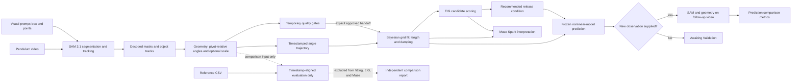

# ProbeLab
### From Observation to Discovery

**An AI-powered scientific experimentalist that transforms visual observations into physical understanding, autonomously designs informative experiments, and generates testable predictions.**

**Team:** ULTRAGENIS  
**Event:** Meta Global AI Developer Hackathon

[](https://www.python.org/)
[](https://fastapi.tiangolo.com/)
[](https://ai.meta.com/)
[](https://ai.meta.com/)
[](https://numpy.org/)
[](https://scipy.org/)
[](LICENSE)

ProbeLab currently focuses on a damped pendulum. A person supplies the video and carries out any physical setup changes; ProbeLab processes the evidence, recommends an informative condition, and produces a model-based forecast.

## Demo

The repository has no public YouTube demo URL. The application includes a **Cached Demo Replay** for a saved phone-recorded pendulum simulator run. Choose **Open Cached Demo Replay**, then **Play 3-Minute Demo**. Playback uses saved SAM, inference, EIG, prediction, and Muse artifacts; it does not call SAM or Muse again.

The replay files and source video live under the ignored `data/` directory and are not included in Git. A fresh clone needs the saved demo artifact bundle placed there before Cached Demo Replay can load. The live dashboard can be used independently with a new video.

## Why ProbeLab?

**Traditional AI answers scientific questions. ProbeLab investigates them.**

An answer alone does not establish how a physical system behaves. An investigation needs observations, a model that can be compared with those observations, uncertainty about the model's parameters, and a follow-up experiment that can distinguish competing explanations. ProbeLab brings those steps into one evidence-centered workflow. Its numerical code owns measurements, parameter estimates, and experiment selection; Muse Spark explains those results without choosing a different action.

## How ProbeLab Works

1. A person uploads a video and identifies the pendulum bob with a visual prompt; text-prompt SAM mode is also available.
2. Meta SAM 3.1 returns segmentation masks and per-frame object tracks.
3. ProbeLab decodes the masks, computes centroids, and converts their positions relative to a pivot into signed angular measurements. A separate validation workflow supports explicit pivot and two-endpoint metric calibration annotations.
4. A grid-based posterior estimates effective length and damping from the measured angle trajectory.
5. The Expected Information Gain (EIG) selector scores configured release angles and recommends the highest-scoring candidate under its endpoint-observation model.
6. Muse Spark receives numerical results for interpretation. It does not calculate or override the posterior or EIG decision.
7. ProbeLab can freeze a trajectory prediction from the selected condition and fitted parameters.
8. A subsequently uploaded observation can be compared with the frozen prediction. The saved demo has no independent follow-up observation, so its validation state is **Awaiting Validation**.

Physical experiments remain human-operated: a person must set the pendulum and provide the resulting video.



The quality-gated perception-validation handoff is separate from the live and cached replay paths. It requires current SAM tracking, geometry, metric calibration, and simulator-leakage checks before its measurements enter the production fit. Reference CSV data have a separate comparison-only path.

## Core Innovations

- **Visual perception connected to physics:** SAM's mask-derived tracks become timestamped measurements for a pendulum model.
- **Uncertainty-aware inference:** parameter estimates come with weighted-grid 68% credible intervals rather than only a single best-fit value.
- **Information-guided follow-up:** the numerical EIG selector compares candidate initial angles using expected posterior entropy reduction.
- **Evidence-grounded interpretation:** Muse Spark receives fixed numerical outputs and explains their meaning; it cannot replace those outputs.
- **Forecast before follow-up:** a prediction can be saved before a validation observation is processed, keeping forecast and observation distinct.
- **Repeatable presentation:** the cached replay presents saved artifacts without repeating expensive model calls.

These components make a compact scientific discovery loop. They do not establish that the inferred model generalizes to a physical pendulum; the saved demonstration is simulator-based.

## Meta AI Integration

### Meta SAM 3.1

ProbeLab sends a guided box-and-point prompt and video to Meta's Responses API using the `sam-3.1` model. It parses returned segmentation masks, preserves the selected object ID, and derives centroids from mask pixels. Text-prompt video segmentation is also implemented. In the live workflow, an unsuccessful SAM request is reported and OpenCV contour tracking may be used as a clearly labeled fallback. The isolated SAM test pages do not hide failures behind that fallback.

SAM supplies the visual object segmentation that connects the video to geometry. It does not infer pendulum parameters or select experiments.

### Meta Muse Spark

ProbeLab calls `muse-spark-1.3` through Meta's OpenAI-compatible Chat Completions endpoint. Muse receives the numerical fit, uncertainty, EIG selection, and prediction status for explanation. The deterministic physics and EIG code remain authoritative. The cached experiment includes a completed real Muse response with its model, completion status, response ID, usage, and session provenance; replay displays that saved response without another API call.

## Scientific Methodology

The current model is a damped nonlinear pendulum with fixed gravity:

\[
\ddot{\theta} + 2\beta\dot{\theta} + \frac{g}{L}\sin(\theta) = 0,
\]

where \(L\) is effective length, \(\beta\) is the damping coefficient, and \(\theta\) is angular displacement from the downward vertical. The forward simulation uses SciPy's `solve_ivp`; the posterior grid evaluates candidate trajectories with a fixed-step RK4 implementation.

The estimator places a uniform discrete prior over length and damping grids, then weights grid points by an angular residual likelihood. Its likelihood scale is currently a data-derived heuristic, \(\sigma = \max(0.08\,\mathrm{SD}(\theta_{obs}), 0.35^\circ)\). Reported 68% intervals are weighted 16th-to-84th percentile intervals. In the saved demo fit, initial angular velocity is treated as a bounded nuisance parameter and marginalized over a uniform grid; gravity is fixed at 9.80665 m/s². These are grid-based posterior approximations, not MCMC samples.

EIG compares the configured candidate angles using noisy endpoint-angle predictions at 8 seconds, with 1° assumed measurement noise in the saved demo. The reported selection is the highest score among those candidates, not a global optimum over all possible experiments.

## Experimental Demonstration

The saved run analyzed a **phone-recorded simulator**, providing synthetic validation rather than physical experimental proof.

| Result | Saved value |
| --- | ---: |
| SAM 3.1 detections | 56 / 56 |
| Effective length | 0.8047 m |
| Length 68% interval | 0.7721–0.8211 m |
| Damping coefficient | 0.04387 s⁻¹ |
| Damping 68% interval | 0.01958–0.07303 s⁻¹ |
| Angular RMS residual | 1.273° |
| Selected experiment | 66° for 8 seconds |
| Expected information gain | 2.855 nats |
| Frozen prediction | 180 model-generated samples |
| Muse Spark interpretation | Completed · `muse-spark-1.3` |
| Independent prediction validation | Awaiting a follow-up observation |

The residual is below the implementation's 3° model-adequacy threshold for this saved fit. The reference CSV comparison is evaluation-only and is not evidence that the frozen prediction was independently validated. The saved replay also does not use metric calibration for its inference and does not establish a calibrated physical length.

## Installation and Running

### Prerequisites

- Python 3.11 or newer
- [`uv`](https://docs.astral.sh/uv/) for the locked setup, or `pip`
- A Meta API credential for SAM 3.1 and Muse Spark requests

### Clone and install

```bash
git clone https://github.com/swankystark/probelab.git
cd probelab
uv sync
```

Alternatively, install with Python's built-in virtual environment and `pip`:

```powershell
py -3.11 -m venv .venv
.\.venv\Scripts\Activate.ps1
python -m pip install -e .
```

### Configure Meta API access

Create a root-level `.env` file (it is ignored by Git) containing the variable read by the Meta clients:

```dotenv
META_API=your_meta_api_key
```

Keep the real credential private. Without `META_API`, local pages and deterministic numerical tools can still be opened, but SAM and Muse requests cannot complete; the live video workflow may report and use its transparent OpenCV fallback.

### Start ProbeLab

The FastAPI backend serves the web dashboard and its static files; a separate frontend server or build is not required.

With `uv`:

```bash
uv run uvicorn probelab.main:app --reload --host 127.0.0.1 --port 8000
```

With the activated virtual environment:

```bash
uvicorn probelab.main:app --reload --host 127.0.0.1 --port 8000
```

Open <http://127.0.0.1:8000>.

### Open the saved demo

1. On the landing page, choose **Open Cached Demo Replay**.
2. Wait for the saved experiment to load.
3. Click **Play 3-Minute Demo**.

Playback uses the cached artifacts and does not make SAM or Muse API calls. The optional one-time Muse action is separate from playback. The local `data/` artifacts must be present as noted in the [Demo](#demo) section.

### Run a live experiment

Choose **Start a Live Experiment**, create an investigation, upload the pendulum video, and draw a box with a positive point on the bob for guided SAM. Review the measured trajectory, parameter fit, adequacy state, and EIG recommendation. A person must set the recommended physical condition and supply its video. Freeze a prediction before uploading a follow-up video to compare it with the forecast. Use evidence-based calibration values; the setup form's default reference values are not a calibration measurement.

Other pages include the isolated SAM tests at `/sam-test` and `/sam-video-test`, the production-engine dashboard at `/engine_test`, and the temporary perception-validation workflow embedded below the live dashboard.

## Project Architecture

```text
probelab/
  main.py                         FastAPI routes and live/replay orchestration
  science.py                      Pendulum simulation, posterior fit, EIG selector
  perception.py                   Video preparation, SAM geometry, OpenCV fallback
  sam_client.py                   Meta SAM 3.1 Responses API integration
  meta_client.py                  Muse Spark API adapter and response diagnostics
  demo_muse.py                    Isolated saved-demo interpretation and provenance
  perception_validation/          Sampling, annotations, sanitization, quality gates,
                                  CSV comparison, and explicit production handoff
  engine_test/                    Dashboard adapters and isolated result persistence
  engine_test_evaluation.py       Independent numerical reference comparisons
web/
  index.html                      Live and cached-replay dashboards
  app.js, demo.js                 Live interactions and cached replay stages
  styles.css                      Dashboard styling
  perception-validation.*         Temporary validation UI
  engine_test.*                   Production-engine testing dashboard
tests/                            Automated regression and workflow tests
data/                             Ignored local uploads, sessions, logs, and artifacts
pyproject.toml                    Project dependencies and tool settings
uv.lock                           Locked dependency resolution
LICENSE                           MIT License
```

## Technology Stack

- **Backend:** Python, FastAPI, Uvicorn, Pydantic
- **Visual perception:** Meta SAM 3.1, `meta-sam-parser`, OpenCV fallback
- **Scientific computing:** NumPy, SciPy (`solve_ivp`)
- **AI interpretation:** Meta Muse Spark through the OpenAI Python SDK
- **Frontend:** HTML, CSS, and vanilla JavaScript
- **Persistence:** JSON session and result artifacts stored locally under `data/`

## Scope and Future Vision

The implemented scientific model and workflow focus on pendulum motion. The cached run is based on a phone recording of a simulator; no independent follow-up observation has validated its frozen prediction, and the current demo does not establish metric calibration or physical experimental proof. The live workflow also depends on a person to manipulate the setup and collect follow-up video.

Future work could add validated models and measurement protocols for other physical systems, richer observation-noise models, and broader experiment spaces. Those extensions are not part of the current implementation.

## Hackathon

- **Project:** ProbeLab — AI Scientific Experimentalist
- **Team:** ULTRAGENIS
- **Event:** Meta Global AI Developer Hackathon

## License

ProbeLab is distributed under the [MIT License](LICENSE).
